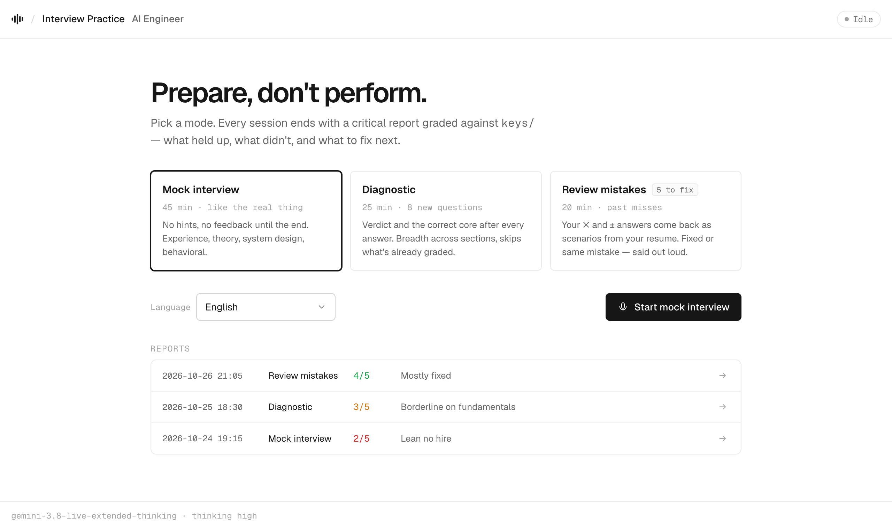
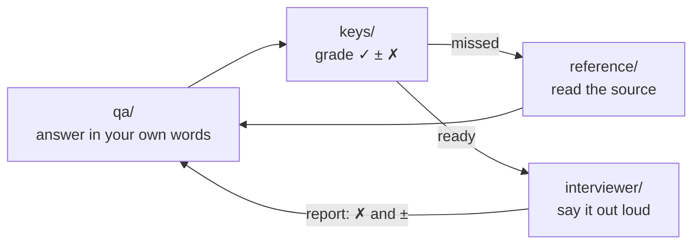

<p align="center">
  
</p>

<!-- banner: generated via ElevenLabs Flows (gemini-3-pro-image) -->

<h1 align="center">AI Engineering Interview Prep</h1>

<p align="center">
  <b>571 questions · grading keys · offline sources · a voice interviewer that tells you what's wrong</b>
</p>

<p align="center">
  <a href="#sections"></a>
  <a href="#sections"></a>
  <a href="interviewer/README.md"></a>
  <a href="LICENSE"></a>
</p>

<p align="center">
  <a href="#quick-start">Quick start</a> ·
  <a href="#voice-practice">Voice practice</a> ·
  <a href="#written-practice">Written practice</a> ·
  <a href="#sections">Sections</a> ·
  <a href="#repository-layout">Layout</a>
</p>

---

Interview-prep workspace built on top of [amitshekhariitbhu/ai-engineering-interview-questions](https://github.com/amitshekhariitbhu/ai-engineering-interview-questions). It turns a question list into a full prep loop:

- **Answer** a question in writing or out loud.
- **Grade** the answer against a key: must-cover points, common mistakes, red flags.
- **Dig** into the original source article when you missed.
- **Drill** the misses until they stick.

The goal is to prepare, not to feel good. Keys and reports are deliberately blunt.

## Quick start

```bash
git clone https://github.com/ssuvorin/ai-engineering-interview-prep.git
cd ai-engineering-interview-prep
```

- **Written:** open [`qa/01-must-know.md`](qa/01-must-know.md), answer under `## Your answer`, then check [`keys/01-must-know.md`](keys/01-must-know.md).
- **Voice:** needs [uv](https://docs.astral.sh/uv/), a local LiveKit server and a free [Gemini API key](https://aistudio.google.com/apikey).

  ```bash
  brew install livekit
  cd interviewer && cp .env.example .env   # add GOOGLE_API_KEY
  uv sync && ./dev.sh                      # open http://localhost:5180
  ```

## Voice practice

A voice AI interviewer in the browser, built on [LiveKit Agents](https://github.com/livekit/agents) and Gemini Live (`gemini-3.8-live-extended-thinking`). It runs locally and draws its questions from `keys/`.

<picture>
  <source media="(prefers-color-scheme: dark)" srcset="assets/interviewer/home-dark.png">
  
</picture>

| Mode | Length | What happens |
|---|---|---|
| **Mock interview** | 45 min | As close to the real thing as possible: experience deep-dive, theory, system design, behavioral. Probing follow-ups. No hints and no feedback until the end. |
| **Diagnostic** | 25 min | Questions you haven't been graded on yet, picked breadth-first. After each answer: a verdict, what was wrong, and the correct core. |
| **Review mistakes** | 20 min | Your earlier ✗ and ± answers come back as scenarios from your own resume. Fixed, or the same mistake again? |

Every session ends with a **critical report**. A grader model reads the transcript and grades your *first* answer to each question; anything you said after a hint doesn't count. Strengths appear only where there is evidence. Anything still at ✗ or ± goes into the queue for the next review session.

<picture>
  <source media="(prefers-color-scheme: dark)" srcset="assets/interviewer/report-dark.png">
  
</picture>

<sub>Demo report with fictional data.</sub>

Setup, modes and tuning are described in [`interviewer/README.md`](interviewer/README.md).

## Written practice



### 1. Answer

Open a file in `qa/`, for example [`qa/04-retrieval-augmented-generation-rag.md`](qa/04-retrieval-augmented-generation-rag.md):

```markdown
### 7. How does embedding model choice affect RAG quality?

## Your answer
```

Write in your own words; bullets are enough. Treat it like a real interview: structure, numbers, no fluff.

### 2. Grade against the key

Each `qa/` file has a matching `keys/<same-name>.md`. Every question there has an ideal answer, must-cover points, common mistakes and red flags.

| Mark | Meaning |
|:---:|---|
| **✓** | Covered the must-cover points |
| **±** | Partial: the key lists what's missing |
| **✗** | Wrong or empty: read the ideal answer, then the source |

Keys are written in Russian. The grading loop works the same in any language. Don't peek before you answer.

### 3. Go to the source

[`reference/_qmap.json`](reference/_qmap.json) maps every question to its source articles. They are fetched as full text, so this works offline. `_manifest.json` maps each source URL to a local file, and [QUESTIONS.md](QUESTIONS.md) keeps the original links.

### 4. Resume deep-dive

[`qa/16-resume-deep-dive.md`](qa/16-resume-deep-dive.md) is a subject-matter drill: 30 questions about *your* experience, testing whether you can defend every bullet on your resume. It covers self-presentation, the flagship project, architecture decisions, engineering process, data and metrics, and pressure questions.

The resume is **not in this repo**. Put yours at `resume/resume.md` (gitignored). The voice interviewer uses it for the experience block and checks your claims against it.

### Suggested order

```
01 → 02 → 04 → 05 → 03 → 07 → 09 → 10 → 13 → 06 → 08 → 12 → 11 → 14 → 15 → 16
```

Core first, periphery last. Section 16 fits anywhere. A realistic pace is 20–30 questions a day.

## Sections

| # | Section | Questions |
|---|---|---:|
| 01 | [Must Know](qa/01-must-know.md) | 6 |
| 02 | [LLM Fundamentals](qa/02-llm-fundamentals.md) | 80 |
| 03 | [Prompt Engineering](qa/03-prompt-engineering.md) | 30 |
| 04 | [Retrieval-Augmented Generation (RAG)](qa/04-retrieval-augmented-generation-rag.md) | 42 |
| 05 | [AI Agents and Agentic Systems](qa/05-ai-agents-and-agentic-systems.md) | 53 |
| 06 | [Fine-Tuning and Model Adaptation](qa/06-fine-tuning-and-model-adaptation.md) | 32 |
| 07 | [Vector Databases and Embeddings](qa/07-vector-databases-and-embeddings.md) | 26 |
| 08 | [AI System Design](qa/08-ai-system-design.md) | 49 |
| 09 | [LLMOps and Production AI](qa/09-llmops-and-production-ai.md) | 53 |
| 10 | [Evaluation and Testing](qa/10-evaluation-and-testing.md) | 36 |
| 11 | [AI Safety, Ethics, and Responsible AI](qa/11-ai-safety-ethics-and-responsible-ai.md) | 45 |
| 12 | [Multimodal AI](qa/12-multimodal-ai.md) | 30 |
| 13 | [AI Infrastructure and Scalability](qa/13-ai-infrastructure-and-scalability.md) | 35 |
| 14 | [Coding and Practical Implementation](qa/14-coding-and-practical-implementation.md) | 32 |
| 15 | [Behavioral and Scenario-Based Questions](qa/15-behavioral-and-scenario-based-questions.md) | 22 |
| 16 | [Resume Deep-Dive](qa/16-resume-deep-dive.md) | 30 |

## Repository layout

```
.
├── qa/              # working zone: 16 files, an empty "Your answer" slot under every question
├── keys/            # grading keys: ideal answer, must-cover points, mistakes, red flags
├── reference/       # ~144 fetched source articles + URL and question maps
├── interviewer/     # voice practice: LiveKit agent, web UI, report grader
├── QUESTIONS.md     # upstream question list, unmodified, with source links
└── HOW-TO-STUDY.md  # the study loop (in Russian)
```

> [!NOTE]
> Personal data stays local and is gitignored: `resume/`, `interviewer/.env` (your API key), `interviewer/sessions/` (transcripts) and `interviewer/reports/`.

## Credits

- Questions and source links: [Amit Shekhar / Outcome School](https://github.com/amitshekhariitbhu/ai-engineering-interview-questions). See [QUESTIONS.md](QUESTIONS.md) and [LICENSE](LICENSE).
- Study structure, answer keys, reference corpus and voice interviewer: this repo.
