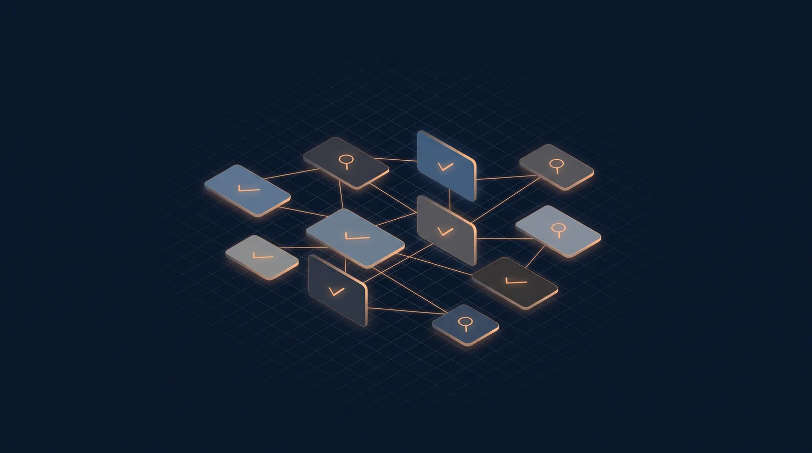

<p align="center">
  
</p>

# AI Engineering Interview — Study Workspace


<!-- banner: generated via ElevenLabs Flows (gemini-3-pro-image) -->
> Interview-prep workspace built on top of [amitshekhariitbhu/ai-engineering-interview-questions](https://github.com/amitshekhariitbhu/ai-engineering-interview-questions): **571 theory questions** across 15 sections, a **30-question resume deep-dive** (предметное интервью), grading answer keys, and a fully local reference corpus for every question.

The upstream question list lives in [QUESTIONS.md](QUESTIONS.md). This repo turns it into a complete self-study loop — read a question, answer it yourself, grade against a key, dig into the original source article if you missed.

## Repository structure

| Path | What it is |
|---|---|
| `qa/` | **Working zone.** 16 files, one per section. Every question has an empty `## Your answer` slot — fill it in bullet form. |
| `keys/` | **Grading keys.** Compact answer keys per section: `Идеал` (ideal answer) → `Обязательные пункты` (must-cover points) → `Частые ошибки` (common mistakes) → `Красные флаги` (red flags). Large sections split into `.part2`/`.part3`. Don't peek before answering. |
| `reference/` | **Source corpus.** ~144 fetched articles behind the upstream question list — Outcome School blogs, Substack posts, YouTube transcripts, LinkedIn/X posts. `_manifest.json` maps URL → file, `_qmap.json` maps section → question → source files. The original links also stay in [QUESTIONS.md](QUESTIONS.md). |
| `QUESTIONS.md` | Original upstream question list, unmodified — including the **"Sources / further reading" links to the full answers** each question is based on. |
| `HOW-TO-STUDY.md` | The study loop, in Russian. |
| `resume/` | **Not committed** — your local resume (`resume/resume.md`) for generating your own section-16 variant. |

## How to work with it

### 1. Pick a section and answer

Open a file in `qa/` — e.g. `qa/04-retrieval-augmented-generation-rag.md`. Every question looks like:

```markdown
### 7. How does embedding model choice affect RAG quality?

## Your answer
```

Write your answer under `## Your answer` — your own words, bullet form is enough. Treat it like a real interview: structure, numbers, no fluff.

### 2. Grade yourself against the key

Each `qa/` file has a matching `keys/<same-name>.md`. For every question:

- **✓** — you covered the `Обязательные пункты`
- **±** — partial; the key lists what you're missing
- **✗** — wrong or empty; read `Идеал`, then the linked `reference/<slug>.md` article for the deep explanation

The keys also carry `Частые ошибки` and `Красные флаги` — the patterns that make interviewers tune out.

### 3. Go to the source when a key isn't enough

`reference/_qmap.json` maps every question to its source articles — fetched full text, so it works offline. For anything bigger than a gap-fix, read the original: `_manifest.json` maps source URL → local file, and [QUESTIONS.md](QUESTIONS.md) keeps the raw outbound links.

### 4. Resume deep-dive (section 16)

`qa/16-resume-deep-dive.md` is a **предметное интервью** — 30 questions built from a resume, not theory: *"can you defend every bullet on your resume"*. Six groups: self-presentation → flagship project deep-dive → architecture decisions → engineering process → data/metrics background → honesty & pressure questions.

The resume itself is **not in this repo** — to generate your own version of this section, put your resume at `resume/resume.md` (gitignored) and build a matching key file grading: fact consistency with the resume → stable pre-prepared answers for anything the resume doesn't cover (`[нужна заготовка]` in keys) → sounding like the person who actually built it.

### 5. Suggested order (core → periphery)

```
01 → 02 → 04 → 05 → 03 → 07 → 09 → 10 → 13 → 06 → 08 → 12 → 11 → 14 → 15 → 16
```

Section 16 works anytime — it's about your own experience, not theory. Realistic pace: 20–30 questions a day.

## Sections

| # | Section | Questions |
|---|---|---|
| 01 | [Must Know](qa/01-must-know.md) | 6 |
| 02 | [LLM Fundamentals](qa/02-llm-fundamentals.md) | 80 |
| 03 | [Prompt Engineering](qa/03-prompt-engineering.md) | 30 |
| 04 | [Retrieval-Augmented Generation (RAG)](qa/04-retrieval-augmented-generation-rag.md) | 42 |
| 05 | [AI Agents and Agentic Systems](qa/05-ai-agents-and-agentic-systems.md) | 53 |
| 06 | [Fine-Tuning and Model Adaptation](qa/06-fine-tuning-and-model-adaptation.md) | 32 |
| 07 | [Vector Databases and Embeddings](qa/07-vector-databases-and-embeddings.md) | 26 |
| 08 | [AI System Design](qa/08-ai-system-design.md) | 49 |
| 09 | [LLMOps and Production AI](qa/09-llmops-and-production-ai.md) | 53 |
| 10 | [Evaluation and Testing](qa/10-evaluation-and-testing.md) | 36 |
| 11 | [AI Safety, Ethics, and Responsible AI](qa/11-ai-safety-ethics-and-responsible-ai.md) | 45 |
| 12 | [Multimodal AI](qa/12-multimodal-ai.md) | 30 |
| 13 | [AI Infrastructure and Scalability](qa/13-ai-infrastructure-and-scalability.md) | 35 |
| 14 | [Coding and Practical Implementation](qa/14-coding-and-practical-implementation.md) | 32 |
| 15 | [Behavioral and Scenario-Based Questions](qa/15-behavioral-and-scenario-based-questions.md) | 22 |
| 16 | [Resume Deep-Dive — предметное интервью](qa/16-resume-deep-dive.md) | 30 |

## Credits

- Questions and source links: [Amit Shekhar / Outcome School](https://github.com/amitshekhariitbhu/ai-engineering-interview-questions) — see [QUESTIONS.md](QUESTIONS.md) and [LICENSE](LICENSE).
- Study structure, answer keys, fetched reference corpus: this repo.
