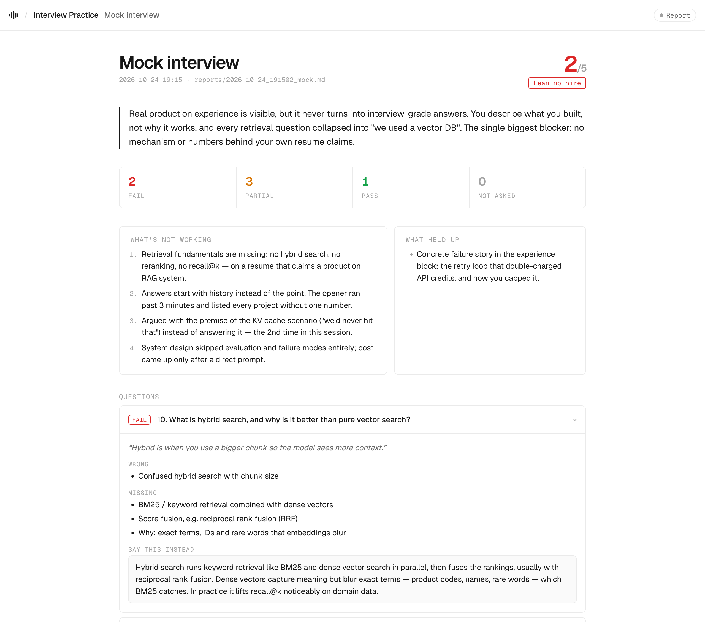

# Voice interview practice

Practice with a voice AI interviewer, built on [LiveKit Agents](https://github.com/livekit/agents) and Gemini Live (`gemini-3.8-live-extended-thinking`). Every session ends with a critical report graded against `keys/`.

<picture>
  <source media="(prefers-color-scheme: dark)" srcset="../assets/interviewer/report-dark.png">
  
</picture>

<sub>Demo report with fictional data.</sub>

## Modes

| Mode | Length | What happens |
|---|---|---|
| **Mock interview** | 45 min | Feels like the real thing: experience deep-dive, 6 theory questions, system design, behavioral. Probing follow-ups. No hints, no praise, no feedback until the end. |
| **Diagnostic** | 25 min | 8 questions you haven't been graded on yet, picked breadth-first across sections. After each answer: a verdict (solid / partial / miss), what was wrong, and the correct core. |
| **Review mistakes** | 20 min | Your latest ✗ and ± answers from earlier reports come back as scenarios tied to your resume. Verdict: fixed / still missing / same mistake. |

The interviewer sees each question's must-cover points from `keys/`. It uses them to aim follow-ups and never reads them out. If they exist locally, it also reads `resume/resume.md` and `notes/diagnostic.md` / `notes/review.md` to check your claims and to find repeated patterns. All of these are optional and are not part of the repo.

## Reports

When a session ends, a text model (`REPORT_MODEL`) grades the transcript. It grades your **first** answer to each item; anything you said after a hint doesn't count. The report contains:
- a score from 1 to 5 against a real interview bar;
- a verdict and a blunt summary;
- problems, ranked;
- strengths, only where there is evidence;
- for each question: grade, quote, what was wrong or missing, and what to say instead;
- repeated patterns and red flags;
- homework.

The report is written in the session language; the "say this instead" answers stay in English, the language of the real interview. Reports open in the UI and are saved to `interviewer/reports/` as `.json` and `.md` (gitignored). Any question still at ✗ or ± goes back into the queue for the review mode.

## Setup

```bash
cd interviewer
cp .env.example .env        # put your GOOGLE_API_KEY here — .env is gitignored
uv sync
brew install livekit        # local LiveKit server
```

Get a Gemini API key at [Google AI Studio](https://aistudio.google.com/apikey).

## Run

```bash
./dev.sh          # LiveKit server + agent + web UI; Ctrl+C stops all three
```

Open http://localhost:5180, pick a mode and a language (English by default; 23 languages supported by Gemini Live), and press **Start**. The interviewer ends the call when it's done; you can also press **End & get report**. Shortcuts during a session: `M` mutes the mic, `T` shows the live transcript, which is hidden by default.

**Terminal only, no server or UI:** set `INTERVIEW_MODE` and `INTERVIEW_LANGUAGE` in `.env`, then:

```bash
uv run agent.py console
uv run report.py sessions/<id>.json     # grade it afterwards
```

## Tuning (`.env`)

| Variable | Default | Effect |
|---|---|---|
| `INTERVIEW_SECTIONS` | `01,02,03,04,05,07,09,10` | `qa/` sections for mock-interview theory questions |
| `THEORY_QUESTIONS` / `DIAGNOSTIC_QUESTIONS` / `REVIEW_ITEMS` | `6` / `8` / `6` | Questions per mode |
| `REPORT_MODEL` | `gemini-3.8-flash` | Grader model. Flash fits the free-tier limits |
| `THINKING_LEVEL` | `HIGH` | `MINIMAL`/`LOW`/`MEDIUM`/`HIGH`. Higher gives sharper follow-ups and slower turns |
| `VAD_PREFIX_MS` / `VAD_SILENCE_MS` | `300` / `1200` | Turn detection: how much speech counts as speech, and how long a pause ends your turn. Raise the first if noise interrupts, the second if it cuts into thinking pauses |
| `VOICE` | `Charon` | Gemini Live voice |
| `INTERVIEW_SEED` | random | Fix this to replay the same question set |
| `WEB_PORT` | `5180` | UI port |
